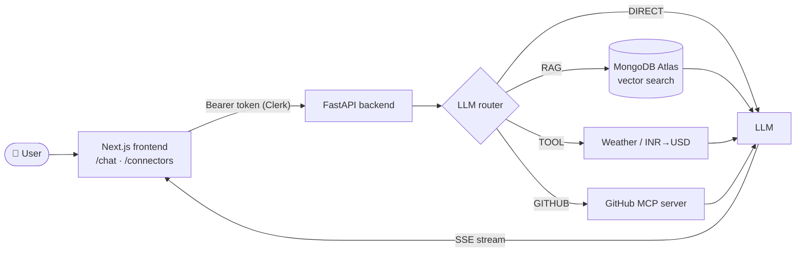

# Kohli RAG — AI chat with documents, live tools and GitHub

A multi-user AI chat assistant. You ask a question, an LLM router decides **how** to answer it, and the answer streams back word by word:

| Route | Answers questions like | How |
|---|---|---|
| **RAG** | "How many centuries has Virat Kohli scored?" | Searches uploaded PDFs (MongoDB Atlas Vector Search) and answers only from them, with sources |
| **TOOL** | "Weather in Chennai?", "Convert ₹5000 to USD" | Calls live tools (Open-Meteo weather, INR→USD) |
| **GITHUB** | "List my repositories", "Open issues in my repo?" | Uses the user's own GitHub account through GitHub's remote **MCP** server (read-only) |
| **DIRECT** | "Explain recursion", "Hi" | The model's general knowledge |

Every user signs in with **Clerk**. The Python backend verifies each request's token, keeps a user profile in MongoDB, and only ever uses **that** user's connected accounts.



---

## Table of contents

- [Features](#features)
- [Tech stack](#tech-stack)
- [Repositories and folder layout](#repositories-and-folder-layout)
- [Getting started](#getting-started)
- [Environment variables](#environment-variables)
- [API reference](#api-reference)
- [Testing](#testing)
- [Security model](#security-model)
- [Troubleshooting](#troubleshooting)
- [Further documentation](#further-documentation)

---

## Features

**Chat**
- Streaming answers over Server-Sent Events (tokens appear as they are generated).
- An LLM router picks one of four routes per question (structured output, never free text).
- Model fallback and retry: Groq → Gemini → Mistral, each retried with exponential backoff before falling back.
- Each answer shows which route and which model answered, the tools it called, and the document sources it used.

**Documents (RAG)**
- PDFs in `uploads/` are ingested at startup: text + tables extracted (PyMuPDF), chunked (300 words, 50 overlap), embedded with `gemini-embedding-001` (3072 dimensions), stored in MongoDB.
- Files are de-duplicated by SHA-256 hash; half-finished ingestions are cleaned up and retried.
- Rate-limit-aware batch embedding — see [docs/batch_processor.md](docs/batch_processor.md).

**Accounts**
- Clerk sign-in / sign-up (our own pages), protected routes, session-expiry handling.
- Backend JWT verification (signature, expiry, issuer, authorized party) on every request.
- MongoDB `users` profile created on the first authenticated request.

**Connectors (MCP)**
- `/connectors` page: GitHub is live; other apps are shown as "Coming soon".
- OAuth 2.0 + PKCE connection flow, tokens encrypted at rest (Fernet), read-only GitHub tools.
- Built so new MCP servers are a catalog entry, not a rewrite — see [docs/connectors.md](docs/connectors.md).

**UI**
- Claude-style layout: collapsible and resizable sidebar, wide conversation column, light/dark theme.
- Works on phones, tablets, desktops and Android TV (larger text, D-pad focus).
- Cookie consent dialog (Accept all / Reject non-essential / Manage).

---

## Tech stack

| Layer | Technology |
|---|---|
| Frontend | Next.js 16 (App Router, Cache Components), React 19, TypeScript, Tailwind CSS 4, shadcn/ui (Radix), TanStack Query, Clerk |
| Backend | Python 3.14, FastAPI, Uvicorn, LangChain 1.5 (`create_agent`, middleware), LangGraph |
| LLMs | Groq `openai/gpt-oss-20b` (primary), Gemini `gemini-3.5-flash-lite`, Mistral `mistral-small-latest` |
| Embeddings | Gemini `gemini-embedding-001` |
| Database | MongoDB Atlas (Motor async driver) + Atlas Vector Search |
| Auth | Clerk (frontend sessions, backend JWT verification via `clerk-backend-api`) |
| MCP | `langchain[mcp]` (`langchain.mcp.MCPAdapter`) on FastMCP 4 / MCP SDK 2, Streamable HTTP |
| Crypto | `cryptography` (Fernet / MultiFernet) |
| Tests | pytest + pytest-asyncio |

---

## Repositories and folder layout

The app is two repositories:

- **Backend** (this repo) — <https://github.com/Harish1404/wiki_rag>
- **Frontend** — <https://github.com/Harish1404/virat-rag-frontend>

The backend follows a **ports and adapters** layout: `app/` holds business logic and never imports vendors directly; `infra/` holds the adapters that talk to MongoDB, Clerk, LLM providers, OAuth and MCP; `app/core/container.py` is the one place that wires them together.

```text
backend/
├── server.py                     # `python server.py` → uvicorn on :8000
├── app/
│   ├── main.py                   # FastAPI app, startup (Mongo, indexes, ingestion), CORS, routers
│   ├── core/
│   │   ├── config.py             # every environment variable, read once
│   │   ├── container.py          # composition root: ports → adapters
│   │   └── encrypt.py            # Fernet token encryption (connectors)
│   ├── routes/                   # HTTP layer only
│   │   ├── chat.py               # POST /llm (SSE)
│   │   ├── users.py              # GET /me
│   │   ├── connectors.py         # /connectors (list, connect, callback, disconnect)
│   │   └── dependencies.py       # CurrentUser: token → User, 401/403/503
│   ├── auth/                     # auth logic: verify → find/create user
│   ├── connectors/               # MCP connector logic (catalog, models, service, ports)
│   └── ai/
│       ├── chat.py               # ChatService: route → handler → SSE events
│       ├── router.py             # LLM router (structured RouteDecision)
│       ├── agent.py              # create_agent + fallback/retry middleware
│       ├── tools/tool.py         # weather_tool, inr_to_usd
│       ├── prompts/              # system prompts, router prompt
│       ├── rag/                  # ingestion, chunking, embeddings, retrieval
│       └── constants.py          # models, routes, limits
├── infra/
│   ├── auth/                     # Clerk token verifier + profile lookup
│   ├── db/                       # Mongo client, repositories, vector store, schemas
│   ├── llm/providers.py          # Groq / Gemini / Mistral clients
│   ├── embeddings/               # Gemini embeddings
│   ├── oauth/                    # OAuth2+PKCE client, GitHub adapter
│   └── mcp/client.py             # per-user MCP client (langchain.mcp)
├── uploads/                      # PDFs ingested at startup
├── tests/                        # pytest (connectors, encryption)
└── docs/                         # architecture, workflow, connectors, batch processor
```

```text
frontend/src/
├── app/
│   ├── layout.tsx                # ClerkProvider (our sign-in URLs), fonts, providers
│   ├── providers.tsx             # theme, TanStack Query, auth bridge, cookie consent
│   ├── page.tsx                  # "/" → redirect to /chat
│   ├── (app)/layout.tsx          # shared shell: sidebar + conversations
│   ├── (app)/chat/page.tsx       # /chat
│   ├── (app)/connectors/page.tsx # /connectors
│   └── sign-in, sign-up          # Clerk forms in our own pages
├── proxy.ts                      # Next.js 16 middleware: protect pages with Clerk
├── lib/                          # api-client (token + 401 retry), auth-token, errors, constants
├── components/                   # ui/ (shadcn), shared/ (app shell, resize handle, ...)
├── features/
│   ├── auth/                     # session bridge, user menu, /me hook
│   ├── chat/                     # chat view, stream parser, message components
│   ├── connectors/               # connectors page, API calls, hooks
│   └── consent/                  # cookie consent banner + settings
└── styles/                       # light.css, dark.css, components.css (design tokens)
```

---

## Getting started

### Prerequisites

- Python 3.12+ (developed on 3.14) and Node.js 20+
- A MongoDB Atlas cluster (Vector Search needs Atlas, not a local MongoDB)
- API keys: Groq and/or Gemini (Mistral optional)
- A Clerk application (publishable + secret key)
- Optional, for GitHub: a GitHub **OAuth App**

### 1. Backend

```bash
cd backend
python -m venv venv
venv\Scripts\activate            # macOS/Linux: source venv/bin/activate
pip install -r requirements.txt
copy .env.example .env           # macOS/Linux: cp .env.example .env — then fill it in
python server.py                 # http://localhost:8000  (docs: /docs)
```

On startup the backend connects to MongoDB, creates indexes and schema validators, ensures the vector index exists, and ingests any new PDFs in `uploads/`.

### 2. Frontend

```bash
cd frontend
npm install
copy .env.example .env           # add your Clerk keys
npm run dev                      # http://localhost:3000
```

### 3. Clerk

1. Create an application at <https://dashboard.clerk.com>.
2. Frontend `.env`: `NEXT_PUBLIC_CLERK_PUBLISHABLE_KEY`, `CLERK_SECRET_KEY`.
3. Backend `.env`: `CLERK_SECRET_KEY`, `CLERK_ISSUER` (your Frontend API URL, e.g. `https://xxx.clerk.accounts.dev`) and `CLERK_AUTHORIZED_PARTIES` (e.g. `http://localhost:3000`).

### 4. GitHub connector (optional)

1. GitHub → Settings → Developer settings → **OAuth Apps** → New.
   - Homepage URL: `http://localhost:3000`
   - Authorization callback URL: `http://localhost:8000/connectors/github/callback`
2. Put the Client ID and a generated client secret in backend `.env` (`GITHUB_CLIENT_ID`, `GITHUB_SECRET_KEY`).
3. Generate an encryption key and set `CONNECTOR_ENCRYPTION_KEYS`:
   ```bash
   python -c "from cryptography.fernet import Fernet; print(Fernet.generate_key().decode())"
   ```
4. Restart the backend, open `/connectors`, click **Connect** on GitHub.

---

## Environment variables

### Backend (`backend/.env`)

| Variable | Required | Purpose |
|---|---|---|
| `GROQ_API_KEY`, `GEMINI_API_KEY`, `MISTRAL_API_KEY` | at least one | LLM providers (Gemini is also used for embeddings) |
| `MONGO_URL`, `DB_NAME` | yes | MongoDB Atlas connection |
| `FRONTEND_URL` | yes | CORS origin of the deployed frontend |
| `CLERK_SECRET_KEY` | yes | Clerk backend API (keys, user profiles) |
| `CLERK_ISSUER` | yes | Expected token `iss`; the app refuses to start without it |
| `CLERK_AUTHORIZED_PARTIES` | recommended | Comma-separated frontend origins allowed to use tokens (`azp`) and to receive OAuth redirects |
| `CLERK_JWT_KEY` | no | PEM public key for fully offline token verification |
| `CONNECTOR_ENCRYPTION_KEYS` | for connectors | Fernet key(s) that encrypt OAuth tokens; first encrypts, all decrypt |
| `GITHUB_CLIENT_ID`, `GITHUB_SECRET_KEY` | for GitHub | Your GitHub OAuth App |
| `GITHUB_CALLBACK_URL` | for GitHub | Must equal the OAuth App's callback URL |
| `GITHUB_REMOTE_SERVER` | no | Default `https://api.githubcopilot.com/mcp` |
| `GITHUB_MCP_TOOLSETS` | no | Default `context,repos,issues,pull_requests,users` |
| `MCP_TIMEOUT_SECONDS` | no | Per MCP request, default 30 |

### Frontend (`frontend/.env`)

| Variable | Purpose |
|---|---|
| `NEXT_PUBLIC_CLERK_PUBLISHABLE_KEY`, `CLERK_SECRET_KEY` | Clerk |
| `NEXT_PUBLIC_CLERK_SIGN_IN_URL`, `..._SIGN_UP_URL`, `..._FALLBACK_REDIRECT_URL` | Optional; the same values are already set in code (`src/lib/constants.ts`) |
| `NEXT_PUBLIC_API_URL` | Backend URL, default `http://localhost:8000` |

Never commit `.env` files. `CLERK_SECRET_KEY`, `GITHUB_SECRET_KEY` and `CONNECTOR_ENCRYPTION_KEYS` are server-only secrets.

---

## API reference

All endpoints except `/`, `/health` and the OAuth callback require `Authorization: Bearer <Clerk session token>`.

| Method | Path | Description |
|---|---|---|
| `GET` | `/health` | Liveness check |
| `GET` | `/me` | The signed-in user's profile (created on first call) |
| `POST` | `/llm` | Body `{"prompt": "..."}` → `text/event-stream` of chat events |
| `GET` | `/connectors` | Connector catalog + this user's connection status (no secrets) |
| `POST` | `/connectors/{key}/connect` | Starts OAuth, returns `{"authorization_url": "..."}` |
| `GET` | `/connectors/{key}/callback` | OAuth redirect target (bound to the user by a one-time `state`) |
| `DELETE` | `/connectors/{key}` | Disconnect (revokes at the provider when possible) |

**SSE events from `/llm`** (each line is `data: {json}`):

| `type` | Fields | When |
|---|---|---|
| `route` | `route`, `reason` | First, always |
| `retrieval_start` / `retrieval_end` | `query` / `results` | RAG route |
| `tool_start` / `tool_end` | `tool`, `input` / `output` | TOOL and GITHUB routes |
| `model` | `model` (e.g. `groq/openai/gpt-oss-20b`) | Before the first token of an answer |
| `token` | `content` | Many times, the answer text |
| `sources` | `sources[]` | RAG route, after the answer |
| `done` | | Success |
| `error` | `message` | Failure at any point |

**Error statuses:** `401` invalid/expired token · `403` deactivated user or disallowed origin · `503` sign-in service or connector unavailable.

---

## Testing

```bash
# Backend
cd backend
python -m pytest              # 24 tests: OAuth state, ownership, refresh, encryption, MCP tool policy

# Frontend
cd frontend
npx tsc --noEmit && npx eslint src && npx next build
```

Backend tests use in-memory fakes ([tests/fakes.py](tests/fakes.py)): no MongoDB, GitHub or secrets are needed.

---

## Security model

- **Two separate identities.** Clerk proves who the app user is. A GitHub OAuth token proves the user allowed *this app* to read their GitHub. They are never mixed.
- **Backend checks everything.** The frontend's page protection is only for user experience; every API call is verified again by the backend.
- **User IDs come only from verified tokens**, never from request bodies. Every connector query is filtered by that user ID.
- **OAuth tokens are encrypted at rest** with a key kept outside the database, and are never sent to the browser or the LLM.
- **Read-only GitHub.** GitHub's read-only mode is requested, and the app also drops any tool the server marks as writing.
- **Tool output is untrusted.** Prompts tell the model never to follow instructions found inside repository files or issues.
- **Logs never contain tokens or codes** — only user IDs, error classes and stable error codes.

---

## Troubleshooting

| Symptom | Cause / fix |
|---|---|
| Redirected to a `*.accounts.dev` page instead of `/sign-in` | Clerk doesn't know our sign-in URL; set in `src/app/layout.tsx` and `src/proxy.ts`. |
| `/me` returns 401 "Invalid or expired session token" | `CLERK_AUTHORIZED_PARTIES` doesn't include your frontend origin, or the PC clock is off (sync it). |
| "Clock skew detected" | System clock is off by more than ~5 s; enable automatic time sync. |
| Startup fails with `collMod` not allowed | Atlas user lacks `dbAdmin`; the app now skips validator updates with a warning. |
| GitHub card shows "Coming soon" | `CONNECTOR_ENCRYPTION_KEYS` or a `GITHUB_*` variable is missing; restart after setting. |
| Assistant asks for your GitHub username | Toolsets must include `context` (provides `get_me`). |

---

## Further documentation

| Document | What it covers |
|---|---|
| [docs/architecture.md](docs/architecture.md) | High-level design: components, layers, data model, deployment |
| [docs/workflow.md](docs/workflow.md) | Step-by-step flow diagrams: a prompt from browser to database and back |
| [docs/connectors.md](docs/connectors.md) | The MCP connector architecture and the full OAuth + tool-call flow |
| [docs/batch_processor.md](docs/batch_processor.md) | How embeddings are batched under rate limits |
