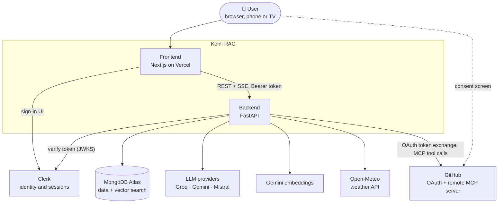
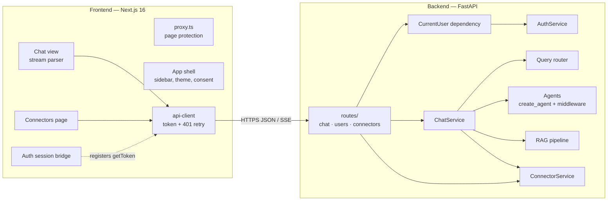
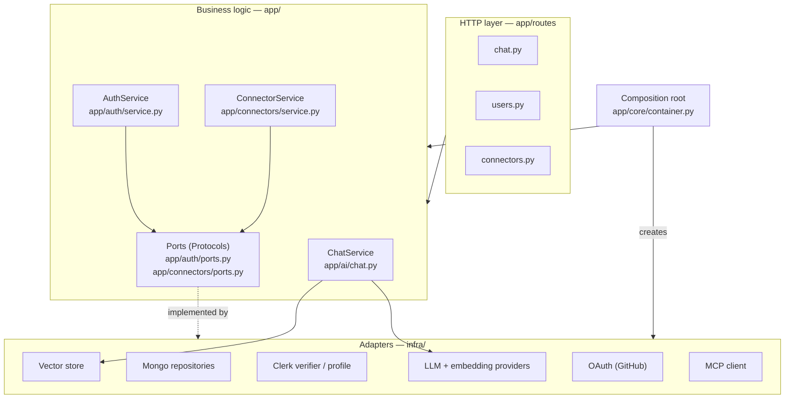
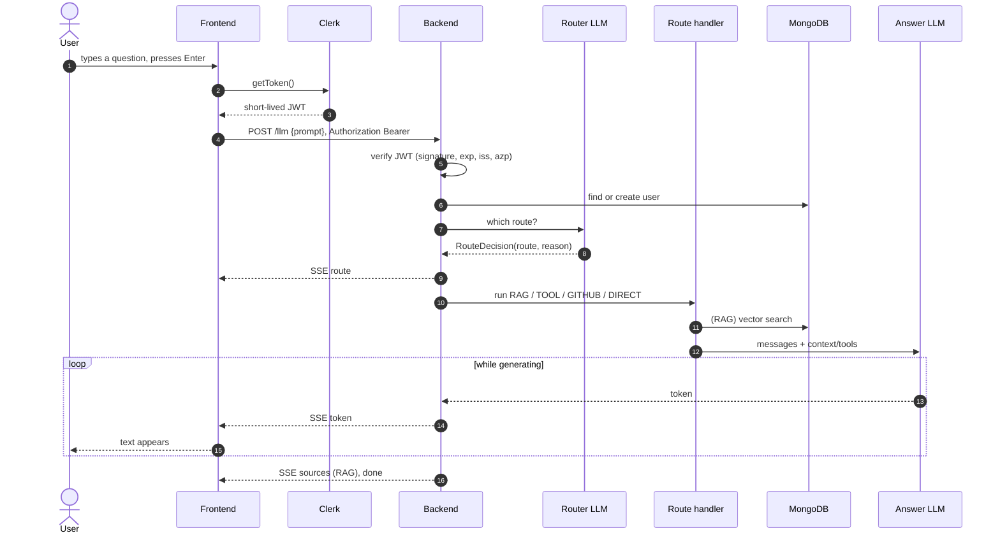
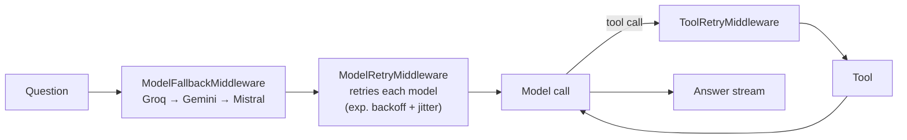
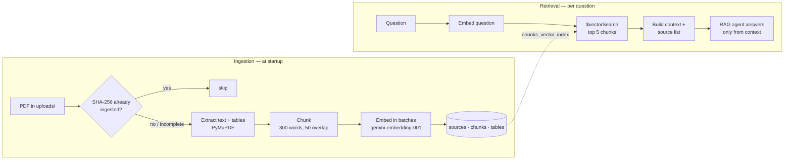
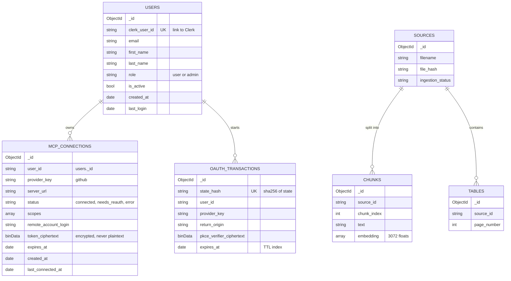
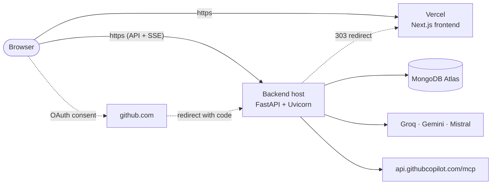

# Architecture (High-Level Design)

This document describes how the whole system is put together: the components, how they talk to each other, where data lives, and why it is built this way. For step-by-step request flows see [workflow.md](workflow.md); for MCP connectors in depth see [connectors.md](connectors.md).

---

## 1. System context

Who and what the system talks to.

| External system | Used for | Called by |
|---|---|---|
| Clerk | Sign-in / sign-up, sessions, short-lived JWTs | Frontend (UI), backend (verification, profile lookup) |
| MongoDB Atlas | Users, documents, chunks + embeddings, connector connections | Backend only |
| Groq / Gemini / Mistral | Routing decisions and answers (with fallback) | Backend only |
| Gemini embeddings | Turning chunks and questions into vectors | Backend only |
| Open-Meteo | Live weather tool | Backend only |
| GitHub | OAuth App consent + remote MCP server (read-only tools) | Backend; the browser only visits GitHub's consent page |

The browser never talks to MongoDB, LLMs or GitHub's API directly, and never sees an API key or a GitHub token.

---

## 2. Containers

The two deployable parts and their main building blocks.

### Frontend responsibilities

| Part | Files | Job |
|---|---|---|
| Page protection | `src/proxy.ts` | Redirect signed-out visitors to `/sign-in` (UX only; the backend is the real gate) |
| Clerk setup | `src/app/layout.tsx` | Our own sign-in/up pages, redirect to `/chat` after sign-in |
| App shell | `src/app/(app)/layout.tsx`, `components/shared/app-shell.tsx` | Collapsible/resizable sidebar; conversations shared between `/chat` and `/connectors` |
| API client | `src/lib/api-client.ts`, `lib/auth-token.ts` | Adds a fresh Clerk token to every request; one retry on 401; friendly errors |
| Auth bridge | `features/auth/components/auth-session-bridge.tsx` | Connects Clerk to the API client; clears cached data on sign-out |
| Chat | `features/chat/*` | Sends the question, parses SSE events, renders answer, tools, sources |
| Connectors | `features/connectors/*` | Lists connectors, starts OAuth (full-page redirect), disconnects |
| Consent | `features/consent/*` | Cookie choices stored in a first-party cookie |

### Backend responsibilities

| Part | Files | Job |
|---|---|---|
| HTTP layer | `app/routes/*` | Validate input, call a service, shape the response |
| Auth | `app/routes/dependencies.py`, `app/auth/*`, `infra/auth/*` | Token → verified Clerk user ID → MongoDB `User` (created on first request) |
| Chat orchestration | `app/ai/chat.py` | Route, run the right handler, stream SSE events |
| Router | `app/ai/router.py` | LLM with structured output picks RAG / TOOL / GITHUB / DIRECT |
| Agents | `app/ai/agent.py` | LangChain `create_agent` with model fallback, model retry, tool retry |
| RAG | `app/ai/rag/*`, `infra/db/mongo_vector_store.py` | Ingest PDFs, embed, vector search, build context |
| Connectors | `app/connectors/*`, `infra/oauth/*`, `infra/mcp/*` | OAuth, encrypted tokens, per-user MCP tools |
| Wiring | `app/core/container.py` | Creates every adapter once and injects it |

---

## 3. Backend layering (ports and adapters)

Business logic depends on small interfaces ("ports"); vendor code lives in adapters. Swapping Clerk, MongoDB or an MCP library means changing an adapter and one line in the container.

Rules the code follows:

1. `app/` never imports Motor, Clerk SDK or FastMCP directly (the AI layer uses LangChain, which is its framework).
2. `infra/` never contains business decisions (who may do what).
3. Routes never touch the database; they call a service.
4. Every user-owned query is filtered by the user ID from the verified token.

---

## 4. Request lifecycle at a glance

A chat question from the browser to the database and back. Detailed diagrams per route are in [workflow.md](workflow.md).

---

## 5. Features and how they are built

### 5.1 Authentication

- **Frontend:** Clerk manages its own secure cookies. `proxy.ts` sends signed-out visitors to `/sign-in`. The API client asks Clerk for a token on every request (Clerk refreshes them automatically) and retries once with a fresh token on 401.
- **Backend:** `ClerkTokenVerifier` checks the RS256 signature against Clerk's cached public keys, the expiry (with 5 s clock leeway), the issuer (`CLERK_ISSUER`) and the authorized party (`CLERK_AUTHORIZED_PARTIES`). The verified `sub` claim is the only source of identity.
- **Provisioning:** on the first request `AuthService` fetches the profile from Clerk once and inserts the user with an atomic upsert guarded by a unique index, so concurrent first requests can't create duplicates.
- **Errors:** 401 (bad token), 403 (deactivated user), 503 (auth dependency down — returned through CORS so the browser shows the right message).

### 5.2 Query routing

`QueryRouter` sends the question to a router model (Mistral → Groq → Gemini, temperature 0) with `with_structured_output(RouteDecision)`, so the result is always a valid `Route` enum. If every router model fails, the question goes to the default route (RAG).

### 5.3 Answer agents and resilience

`build_agent()` creates a LangChain agent with middleware:

RAG, TOOL and DIRECT agents are built once at startup. The GITHUB agent is built **per request**, because its tools carry that user's own GitHub token.

### 5.4 RAG (documents)

Ingestion is idempotent: a file is identified by its hash, a `pending` record is written before chunks, and `completed` only after everything is stored — a crash mid-way is detected and retried on the next start.

### 5.5 Tools

`weather_tool` (Open-Meteo geocoding + forecast) and `inr_to_usd` return readable strings, including on errors, so the agent can explain problems instead of crashing.

### 5.6 MCP connectors (GitHub)

Users connect GitHub once with OAuth 2.0 + PKCE; the token is encrypted and stored per user; on GITHUB questions a fresh MCP client is created with that token, tools are discovered, filtered to read-only, namespaced, and given to a per-request agent. Full details: [connectors.md](connectors.md).

### 5.7 Frontend experience

- Layout: sidebar (collapse with Ctrl+B, drag to resize 13–26 rem, remembered only with "Preferences" consent), 56 rem conversation column.
- Conversations live in memory (React context in the `(app)` layout), so they survive moving between `/chat` and `/connectors`, and are cleared on sign-out or refresh.
- Design tokens in `src/styles/*.css`; every colour comes from CSS variables, so light/dark and TV scaling work everywhere.

---

## 6. Data model (MongoDB)

| Collection | Indexes | Notes |
|---|---|---|
| `users` | unique `clerk_user_id` | No passwords or tokens — Clerk owns credentials |
| `mcp_connections` | unique `(user_id, provider_key)` | `$jsonSchema` validator; token is Fernet ciphertext |
| `oauth_transactions` | unique `state_hash`, TTL on `expires_at` | Read-and-deleted atomically by the callback (single use) |
| `chunks` | Atlas Vector Search `chunks_vector_index` | Embeddings + metadata for retrieval |
| `sources`, `tables` | — | One record per ingested file; extracted tables |

Schema management: Pydantic models (Python) ↔ repositories (`infra/db/*_repository.py`) ↔ MongoDB `$jsonSchema` validators (`infra/db/schemas.py`, applied at startup).

---

## 7. Deployment view

Production checklist:

- Set `FRONTEND_URL` and `CLERK_AUTHORIZED_PARTIES` to the production frontend origin.
- Update the GitHub OAuth App's homepage and callback URLs to the production domains (and `GITHUB_CALLBACK_URL`).
- Generate a **new** `CONNECTOR_ENCRYPTION_KEYS` for production and store it in the host's secret settings.
- Use Clerk production keys.
- Serve both apps over HTTPS.

---

## 8. Design decisions

| Decision | Why |
|---|---|
| LLM router instead of one big agent | Each route gets a focused prompt and toolset; cheaper and more predictable |
| Structured output for routing | The route is always a valid enum, never text to parse |
| SSE streaming | Users see the answer immediately; tool and source events show progress |
| Ports and adapters | Vendors can be swapped; business logic is testable with fakes |
| Backend verifies every token | Frontend protection can be bypassed; the API cannot |
| Per-request GitHub agent | Tools carry one user's token; no shared client can leak across users |
| Encrypted tokens, key outside the DB | A database leak alone doesn't expose anyone's GitHub |
| Catalog of allowed MCP servers | Prevents the backend being used to reach arbitrary hosts (SSRF) |
| In-memory conversations | The backend stores no chat history yet; nothing sensitive persists |
