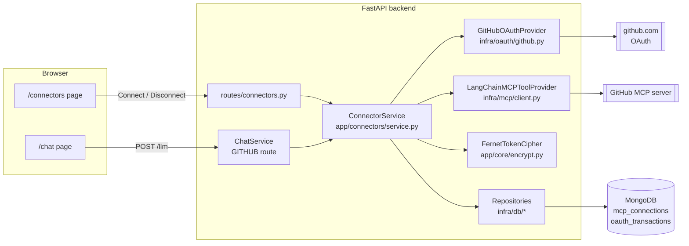
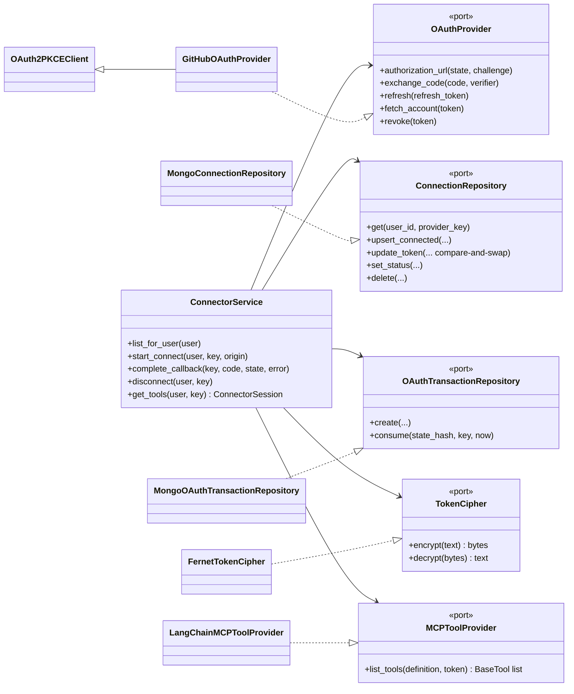
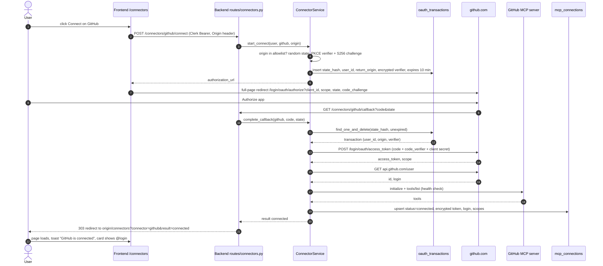
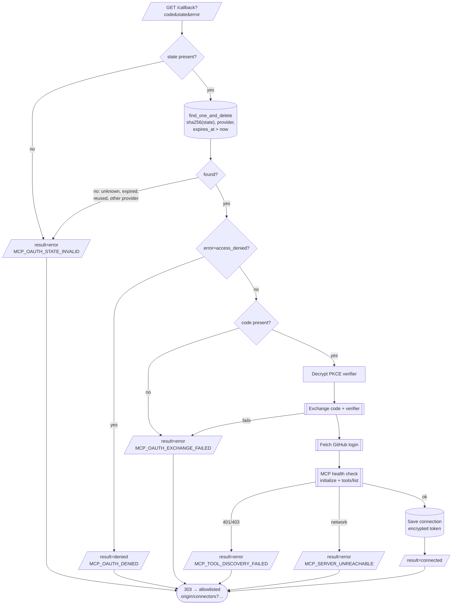
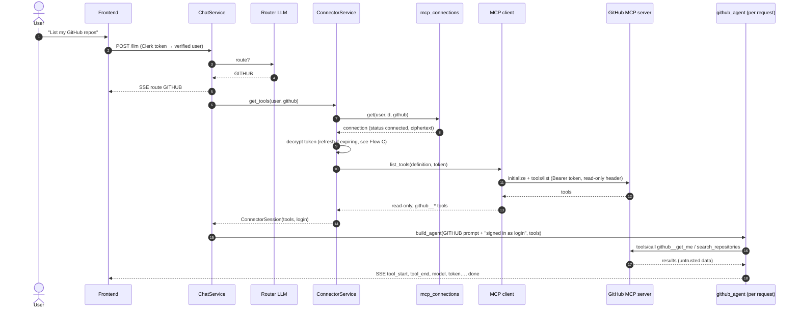
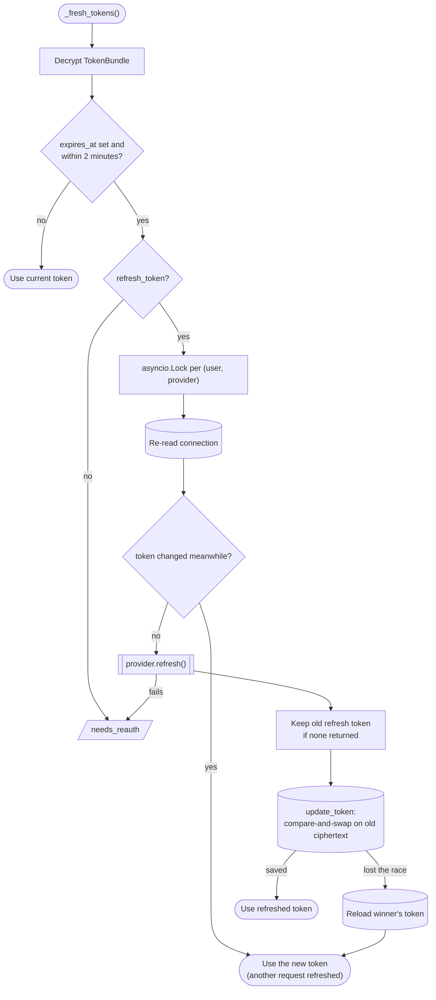
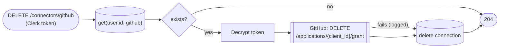
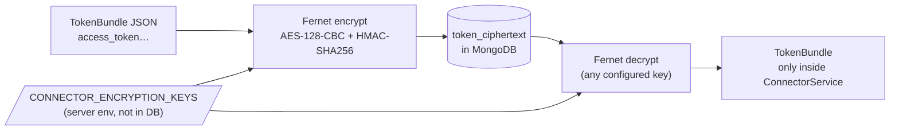
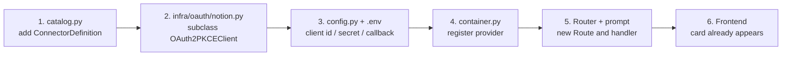

# MCP Connectors — architecture and full flow

This document explains how users connect their own apps (GitHub today, more later) and how the chat assistant uses them through **MCP**. It starts simple and gets more detailed; every important file is explained.

- [1. The idea in plain words](#1-the-idea-in-plain-words)
- [2. Big picture](#2-big-picture)
- [3. How the code is organised (app vs infra)](#3-how-the-code-is-organised-app-vs-infra)
- [4. File-by-file guide](#4-file-by-file-guide)
- [5. Flow A — Connecting GitHub (OAuth)](#5-flow-a--connecting-github-oauth)
- [6. Flow B — Using GitHub in chat](#6-flow-b--using-github-in-chat)
- [7. Flow C — Token refresh](#7-flow-c--token-refresh)
- [8. Flow D — Disconnect](#8-flow-d--disconnect)
- [9. What is stored, and how it is protected](#9-what-is-stored-and-how-it-is-protected)
- [10. Error codes](#10-error-codes)
- [11. Adding a new MCP server](#11-adding-a-new-mcp-server)
- [12. Tests](#12-tests)
- [13. Limits and future work](#13-limits-and-future-work)

---

## 1. The idea in plain words

**MCP (Model Context Protocol)** is a standard way for an AI app to use tools that live on someone else's server. GitHub runs an MCP server at `https://api.githubcopilot.com/mcp`. It offers tools such as `get_me`, `search_repositories` and `list_issues`. Our backend is the **MCP client**: it asks the server "what tools do you have?" (`tools/list`) and later "run this tool with these arguments" (`tools/call`).

To use a person's GitHub, the server needs a **GitHub access token for that person**. We get it with **OAuth**: the user clicks Connect, approves our app on github.com, and GitHub gives our backend a token.

So there are **two separate identities**:

| Identity | Proves | Comes from | Stored |
|---|---|---|---|
| Clerk session token | "This is app user X" | Clerk, on every request | Never stored by us |
| GitHub OAuth token | "User X allowed our app to read their GitHub" | GitHub, once at connect time | MongoDB, **encrypted** |

The rest of this document is about getting, storing and using that second token safely.

---

## 2. Big picture



`ConnectorService` is the centre: it is the only code that sees decrypted tokens, and it hands the chat agent **tools**, never tokens.

---

## 3. How the code is organised (app vs infra)

The connector code follows the same **ports and adapters** pattern as auth:

- `app/connectors/` = **what** should happen (rules, flow, data shapes). No MongoDB, FastAPI or FastMCP imports.
- `infra/` = **how** it talks to the outside world (MongoDB, GitHub OAuth, the MCP library).
- `app/connectors/ports.py` = the contracts (Python `Protocol`s) between the two.
- `app/core/container.py` = creates the real adapters and plugs them into the service.



Why bother? Because each part can change alone. A new provider is a new `OAuthProvider`, a different MCP library is a new `MCPToolProvider`, and the tests swap every adapter for a fake (`tests/fakes.py`) without touching the service.

---

## 4. File-by-file guide

### App layer — the rules (`backend/app/`)

| File | What it does | Why it exists |
|---|---|---|
| `connectors/catalog.py` | The list of servers we support. `GITHUB` = URL, scopes `repo read:org read:user`, headers `X-MCP-Readonly: true` and `X-MCP-Toolsets`, `enabled` only if the GitHub env vars are set | Only catalog servers can be reached (no user-typed URLs → no SSRF). Adding a server starts here |
| `connectors/models.py` | Pydantic shapes: `ConnectorDefinition`, `Connection`, `OAuthTransaction`, `TokenBundle`, `ConnectorView` | One definition of each record. `ConnectorView` is what the API returns and has **no secret fields at all** |
| `connectors/ports.py` | The five interfaces the service needs | Keeps the service independent of MongoDB / GitHub / FastMCP |
| `connectors/errors.py` | `ConnectorError` with stable codes (`MCP_OAUTH_DENIED`, …), `MCPAuthError` | Safe codes for URLs, logs and UI; never raw provider messages |
| `connectors/service.py` | The whole lifecycle (sections 5–8). Also `pkce_pair()`, `hash_state()`, `normalize_origin()` | The only place with decrypted tokens and the only place making connector decisions |
| `core/encrypt.py` | `FernetTokenCipher`: encrypt/decrypt with `MultiFernet`, key rotation | Tokens are never stored readable |
| `core/config.py` | `CONNECTOR_ENCRYPTION_KEYS`, `GITHUB_*`, `MCP_TIMEOUT_SECONDS`, return origins | All settings in one place |
| `core/container.py` | Builds `connector_service` with the real adapters; leaves GitHub out if not configured | The single wiring point |
| `routes/connectors.py` | 4 endpoints; turns `ConnectorError` into HTTP status + `X-Error-Code` header; callback builds the safe redirect | Thin HTTP layer |
| `ai/chat.py` → `_handle_github` | Gets the user's `ConnectorSession`, builds a **per-request** agent, streams it | Where MCP meets the chat |
| `ai/prompts/gemini_prompt.py` | `GITHUB_SYSTEM_PROMPT` (read-only, tool output is untrusted) + `GITHUB_ACCOUNT_PROMPT` (the user's login) | Guides the model and resists prompt injection |
| `ai/prompts/routes.py`, `ai/constants.py` | `Route.GITHUB` and router examples | So GitHub questions reach this route |

### Infra layer — the outside world (`backend/infra/`)

| File | What it does | Why it exists |
|---|---|---|
| `oauth/oauth2_pkce.py` | Generic OAuth 2.0 client: builds the authorize URL (with `code_challenge`, `S256`), exchanges the code (sends `code_verifier`), refreshes. Treats GitHub's "200 with `error`" as a failure | Any standard OAuth provider can reuse it |
| `oauth/github.py` | GitHub endpoints, `fetch_account()` (`GET api.github.com/user` → login), `revoke()` (`DELETE /applications/{client_id}/grant`) | GitHub-specific bits only |
| `mcp/client.py` | `LangChainMCPToolProvider.list_tools()`: builds a FastMCP `StreamableHttpTransport` with `auth=<token>` (Bearer) + catalog headers, wraps it in `langchain.mcp.MCPAdapter`, discovers tools, drops non-read-only tools, renames them `github__*`, caps output at 20,000 chars, maps 401/403 to `MCPAuthError` | The only file that knows the MCP library. Details below |
| `db/schemas.py` | `$jsonSchema` validators for both collections, created/updated at startup (skips updates if the DB user lacks `collMod`) | MongoDB itself rejects malformed documents |
| `db/connection_repository.py` | `mcp_connections` CRUD; every query filters by `user_id`; `update_token` is compare-and-swap; unique `(user_id, provider_key)` | Ownership + no duplicates + safe concurrent refresh |
| `db/oauth_transaction_repository.py` | `create()` and `consume()` = atomic `find_one_and_delete` (single use); TTL index deletes abandoned ones | Replay protection; PKCE verifier leaves the DB as soon as it's used |
| `db/mongo.py` | `get_mcp_connections_collection()`, `get_oauth_transactions_collection()` | Collection names in one place |

### Frontend (`frontend/src/features/connectors/`)

| File | What it does |
|---|---|
| `api/connectors-api.ts` | `listConnectors`, `startConnect` (returns the GitHub URL), `disconnectConnector` — via the shared API client (adds the Clerk token) |
| `hooks/use-connectors.ts` | TanStack Query: list, connect (then `window.location.assign`), disconnect (then refetch) |
| `components/connectors-page.tsx` | Live card for available connectors (Connect / Disconnect / Reconnect, `@login`, read-only note); "Coming soon" for the rest; reads `?connector=&result=&code=` after the redirect, shows a toast, cleans the URL |
| `connectors.ts` | Display list (names, icons, categories) of all apps on the page |

### Inside `infra/mcp/client.py` (the "complex" part)

```mermaid
flowchart TD
    A(["list_tools(definition, token)"]) --> B["_StatusRecorder()<br/>remembers 401/403 on the wire"]
    B --> C["StreamableHttpTransport(<br/>url, headers=X-MCP-Readonly…,<br/>auth=token, httpx_client_factory)"]
    C --> D["fastmcp Client(<br/>timeout, init_timeout)"]
    D --> E["MCPAdapter(client)<br/>langchain.mcp"]
    E --> F[["initialize + tools/list<br/>GitHub MCP server"]]
    F -- exception --> G{"401/403 seen?"}
    G -- yes --> H[/"raise MCPAuthError<br/>(user must reconnect)"/]
    G -- no --> I[/"raise ConnectorError<br/>SERVER_UNREACHABLE /<br/>TOOL_DISCOVERY_FAILED"/]
    F -- ok --> J["For each LangChain tool"]
    J --> K{"server says<br/>read_only_hint = false?"}
    K -- yes --> L["drop it"]
    K -- no --> M["_wrap(): name → github__name,<br/>output capped at 20,000 chars"]
    M --> N(["list of BaseTool"])
```



Why each piece:

- **`_StatusRecorder`** — the MCP SDK turns HTTP errors into a generic `MCPError` without the status code. An httpx event hook records 401/403, so we can tell "token rejected → reconnect" from "server down → try later". (Verified against the real GitHub server with a fake token.)
- **New client per call** — the client carries one user's token. There is no shared, process-wide client, so tokens can't leak between users.
- **`MCPAdapter`** — LangChain's built-in adapter (`langchain[mcp]`) turns MCP tool schemas into LangChain `StructuredTool`s the agent can call. The tool remembers the MCP name internally, so renaming it is safe.
- **Read-only filter** — GitHub's `X-MCP-Readonly` header already hides write tools; the filter is a second, app-side guard.
- **Output cap** — a whole file or long issue thread could flood the model's context.

---

## 5. Flow A — Connecting GitHub (OAuth)

### 5.1 The full sequence



### 5.2 Every check in the callback



What each protection stops:

| Protection | Where | Stops |
|---|---|---|
| Random `state`, stored only as SHA-256 | `service.start_connect`, `hash_state` | Forged callbacks; a DB reader can't reuse states |
| Transaction bound to `user_id` | `oauth_transactions.user_id` | The callback has no Clerk token; the state is what proves who started it |
| Atomic read-and-delete | `consume()` → `find_one_and_delete` | Replay (same link used twice) |
| 10-minute expiry + TTL index | `TRANSACTION_TTL`, `expires_at` index | Old links; abandoned rows piling up |
| PKCE `S256` | `pkce_pair()`, `oauth2_pkce.py` | A stolen authorization code is useless without the verifier |
| Return-origin allowlist | `normalize_origin`, `CONNECTOR_RETURN_ORIGINS` | Open redirect to a malicious site |
| Health check before "connected" | `mcp.list_tools` in callback | Showing "Connected" when the MCP server won't work |
| Only codes in the redirect URL | `CallbackResult` | Leaking tokens or provider messages into browser history |

---

## 6. Flow B — Using GitHub in chat



Key points:

- The **user ID comes from the verified Clerk token**, so `get_tools` can only ever load that user's connection.
- The **agent never sees the token**: it gets LangChain tools whose HTTP client already carries the Bearer header.
- A **new agent per request** — RAG/TOOL/DIRECT agents are shared singletons, but the GitHub agent's tools are user-specific.
- **Not connected?** The route streams "connect GitHub on the Connectors page" instead of failing.
- **Token revoked on GitHub?** The MCP server answers 401 → `MCPAuthError` → connection marked `needs_reauth` → the card shows **Reconnect**.
- **Prompt injection:** tool output (READMEs, issues, code) is treated as data; the system prompt forbids following instructions inside it, and the tools are read-only anyway.

---

## 7. Flow C — Token refresh

GitHub OAuth App tokens normally **don't expire**, so this usually does nothing. It exists for providers (or GitHub settings) that issue expiring tokens with refresh tokens.



Why the lock **and** compare-and-swap: refresh tokens rotate (each can be used once). The lock stops two chats in the same process refreshing at once; compare-and-swap stops two processes from overwriting each other.

---

## 8. Flow D — Disconnect



Revocation is best-effort: even if GitHub is unreachable, the local record is deleted, so the assistant can no longer use it. Revoking the grant also removes the app from the user's "Authorized OAuth Apps" on GitHub.

---

## 9. What is stored, and how it is protected

### `mcp_connections` (one per user per provider)

| Field | Example | Secret? |
|---|---|---|
| `user_id` | `"66f…"` (our `users._id`) | no |
| `provider_key` | `"github"` | no |
| `status` | `connected` / `needs_reauth` / `error` | no |
| `scopes` | `["repo", "read:org", "read:user"]` | no |
| `remote_account_login` | `"octocat"` | no (public) |
| `token_ciphertext` | `gAAAAAB…` (binary) | **encrypted** `TokenBundle` (access + refresh token, expiry) |
| `created_at`, `updated_at`, `last_connected_at`, `expires_at`, `last_error_code` | dates / codes | no |

### `oauth_transactions` (lives ≤ 10 minutes)

`state_hash` (SHA-256, never the raw state), `user_id`, `provider_key`, `return_origin`, `pkce_verifier_ciphertext` (encrypted), `expires_at`.

### Encryption



- The key is generated by you: `python -c "from cryptography.fernet import Fernet; print(Fernet.generate_key().decode())"`.
- **Rotation:** `CONNECTOR_ENCRYPTION_KEYS=newkey,oldkey` — new data uses the first key, old data still decrypts.
- **Lost key:** stored tokens can't be read; users Disconnect and Connect again. Nothing else breaks.
- Without the key, connectors are switched off (the GitHub card shows "Coming soon").

### Where tokens never go

API responses (`ConnectorView` has no token field) · the browser · URLs · logs (only user IDs, error classes, codes) · the LLM prompt.

---

## 10. Error codes

| Code | Meaning | User sees |
|---|---|---|
| `MCP_UNKNOWN_CONNECTOR` | Not in the catalog | 404 |
| `MCP_CONNECTOR_UNAVAILABLE` | Missing env vars or encryption key | 503 / "isn't set up on the server yet" |
| `MCP_INVALID_RETURN_ORIGIN` | Connect started from a non-allowed site | 403 |
| `MCP_OAUTH_STATE_INVALID` | Unknown, expired or reused link | "link expired or was already used" |
| `MCP_OAUTH_DENIED` | User clicked Cancel on GitHub | "You cancelled the connection." |
| `MCP_OAUTH_EXCHANGE_FAILED` | Code exchange failed / no code | "couldn't finish signing in" |
| `MCP_TOOL_DISCOVERY_FAILED` | MCP server rejected the token or answered badly | "server didn't accept the connection" |
| `MCP_SERVER_UNREACHABLE` | Network / timeout | "Couldn't reach the service" |
| `MCP_TOKEN_REFRESH_FAILED` | Refresh failed → `needs_reauth` | Reconnect button |
| `MCP_AUTH_REQUIRED` | Token rejected during chat → `needs_reauth` | Reconnect button |

---

## 11. Adding a new MCP server

Example: a hypothetical "Notion" server that uses standard OAuth 2.0.



1. **Catalog** (`app/connectors/catalog.py`):
   ```python
   NOTION = ConnectorDefinition(
       key="notion",
       display_name="Notion",
       description="Search your pages and team wiki.",
       server_url=settings.NOTION_MCP_URL,
       scopes=[...],                      # from Notion's docs
       read_only=True,
       enabled=bool(settings.NOTION_CLIENT_ID and settings.NOTION_CLIENT_SECRET),
   )
   CATALOG = {GITHUB.key: GITHUB, NOTION.key: NOTION}
   ```
2. **OAuth adapter** (`infra/oauth/notion.py`): subclass `OAuth2PKCEClient`, set `authorize_endpoint` / `token_endpoint`, implement `fetch_account()` and `revoke()`.
3. **Settings**: add the env vars to `config.py` and `.env.example`.
4. **Wire it** in `container.py`: `oauth_providers[NOTION.key] = NotionOAuthProvider(...)`.
5. **Chat**: add `Route.NOTION` + router examples, and a handler like `_handle_github` (calls `get_tools(user, "notion")`). The MCP client, encryption, repositories, schemas and API need **no changes**.
6. **Frontend**: the card switches from "Coming soon" to live as soon as `GET /connectors` reports it `available` (the id in `connectors.ts` must match the key).

If a server supports MCP-standard OAuth discovery / dynamic client registration instead of a pre-registered app, add a new `OAuthProvider` for that — the service doesn't change.

---

## 12. Tests

`python -m pytest` runs 24 tests with in-memory fakes (`tests/fakes.py`):

| Area | Tests |
|---|---|
| Starting | unknown connector, disallowed origin, no encryption key, state stored hashed, verifier encrypted, PKCE S256 correct |
| Callback | success + verifier round trip, replay, missing/unknown state, expired state, wrong provider, denied consent, missing code, MCP health-check failure |
| Ownership | user B can't see, use or disconnect user A's connection |
| Use | revoked token → `needs_reauth`, expiring token refreshed and rotation saved, 5 concurrent refreshes → 1 provider call |
| Leaks | tokens and codes never in API views or logs |
| Crypto / MCP | encrypt round trip, key rotation, wrong key, read-only hint, namespacing, output cap |

---

## 13. Limits and future work

- **Read-only only.** Write tools (create issue, comment) would need a "confirm before acting" step in the UI.
- **No custom server URLs.** Only catalog servers; arbitrary URLs would need SSRF protection (DNS/IP checks).
- **Tools are discovered on every GitHub question** (~1 s). A per-connection cache keyed by user + server version could remove that.
- **Refresh lock is per process.** Compare-and-swap keeps data safe across processes, but two processes could still both call the provider once.
- `langchain.mcp` is **beta**; versions are pinned in `requirements.txt` (`langchain[mcp]==1.5.0`, `fastmcp==4.2.4`).
