# Workflow — how a prompt travels through the app

This document follows one question from the moment the user presses **Enter** to the last word on screen. Every diagram is Mermaid, so GitHub draws it.

### Shape legend

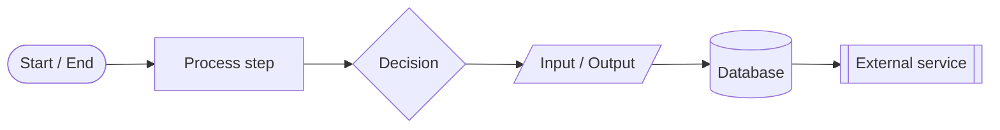

| Shape | Meaning |
|---|---|
| Rounded pill | Start or end of a flow |
| Rectangle | A step the code performs |
| Diamond | A decision / branch |
| Parallelogram | Data going in or out (request, event) |
| Cylinder | MongoDB |
| Double-bordered box | An external service (Clerk, LLM, GitHub, Open-Meteo) |

---

## 1. The whole journey (swimlanes)

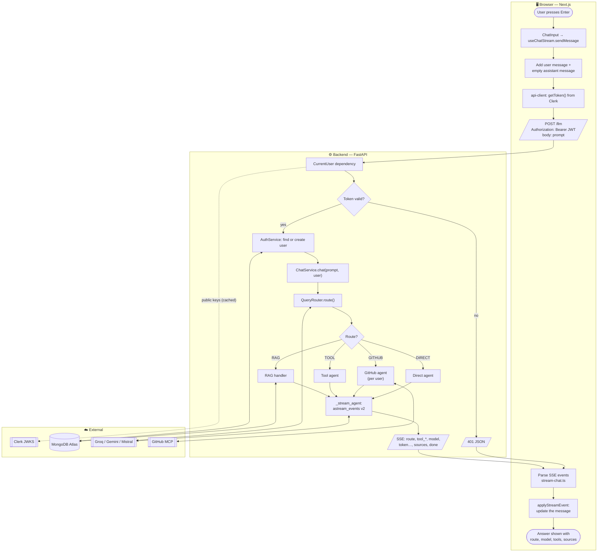

---

## 2. Step 1 — Frontend sends the question

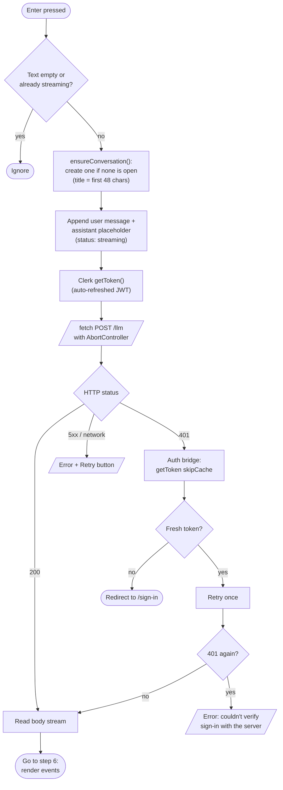

Files: `features/chat/hooks/use-chat-stream.ts`, `features/chat/api/stream-chat.ts`, `lib/api-client.ts`, `lib/auth-token.ts`, `features/auth/components/auth-session-bridge.tsx`.

---

## 3. Step 2 — Backend checks who is asking

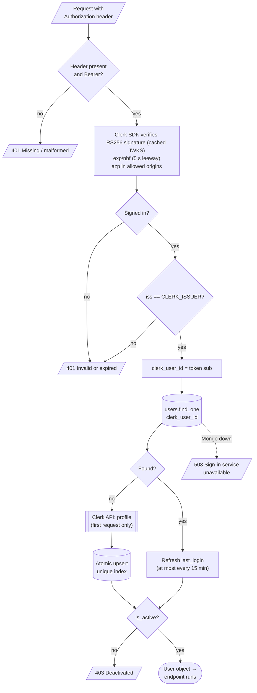

Files: `app/routes/dependencies.py`, `infra/auth/clerk_token_verifier.py`, `app/auth/service.py`, `infra/db/user_repository.py`.

---

## 4. Step 3 — The router picks a route

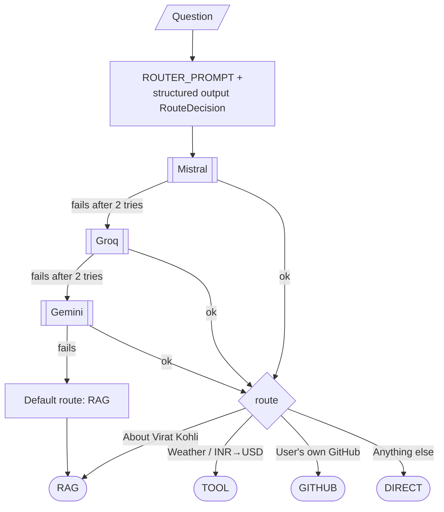

The first SSE event is always `route` with the reason, so the UI can show a "Documents / Tool / GitHub / General" badge.

Files: `app/ai/router.py`, `app/ai/prompts/routes.py`, `app/ai/constants.py`.

---

## 5. Step 4 — Each route

### 5.1 RAG (documents)

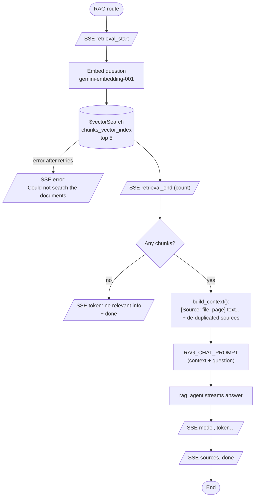

### 5.2 TOOL (weather, currency)

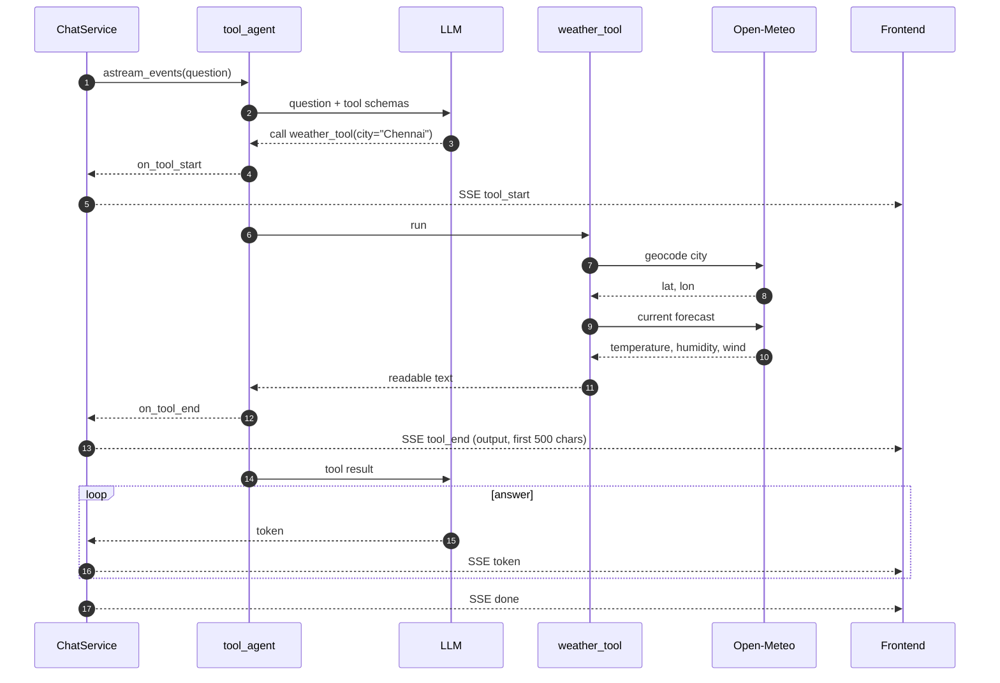

### 5.3 GITHUB (MCP connector)

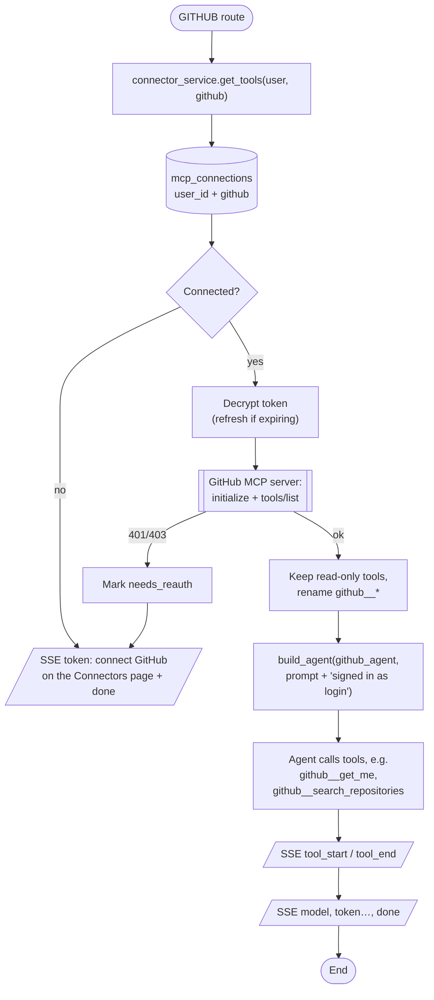

The full MCP story (OAuth, encryption, why each file exists) is in [connectors.md](connectors.md).

### 5.4 DIRECT (general knowledge)

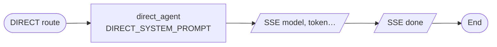

---

## 6. Step 5 — Streaming the answer (backend)

`_stream_agent` turns LangChain's event stream into our SSE events.

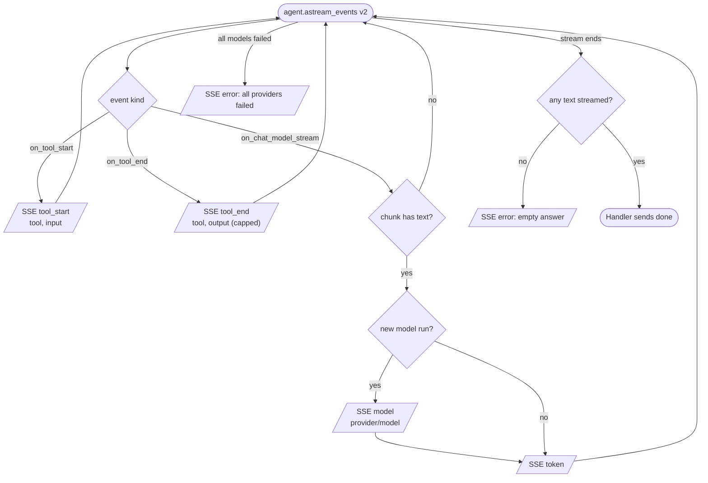

**Fallback during streaming:** if Groq fails, `ModelFallbackMiddleware` switches to Gemini mid-request; the new run ID makes the backend emit a fresh `model` event, so the UI shows which model really answered.

---

## 7. Step 6 — Rendering events (frontend)

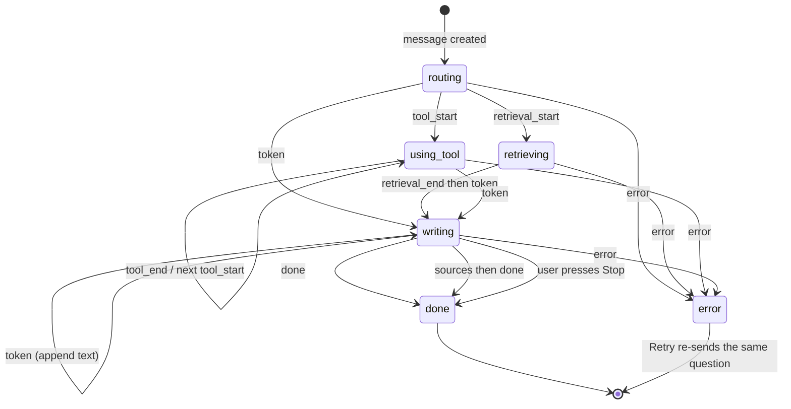

`applyStreamEvent` (pure function) updates one assistant message per event; React re-renders the message list, which keeps scrolled to the bottom unless the user scrolled up to read.

---

## 8. Sign-in and sign-out flow

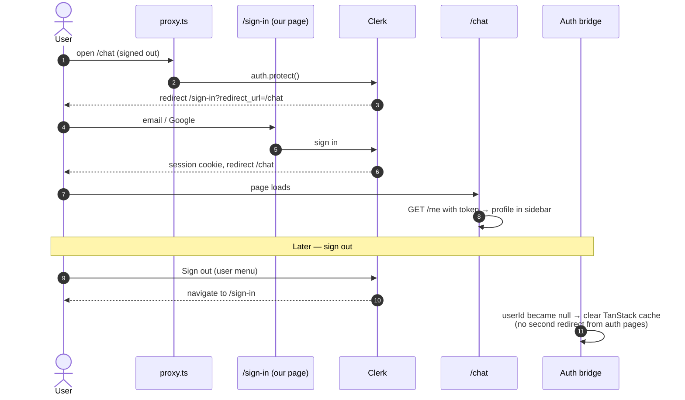

---

## 9. Where each step lives

| Step | Frontend | Backend |
|---|---|---|
| Send question | `features/chat/hooks/use-chat-stream.ts` | `app/routes/chat.py` |
| Token | `lib/api-client.ts`, `lib/auth-token.ts` | `app/routes/dependencies.py`, `infra/auth/clerk_token_verifier.py` |
| User profile | `features/auth/hooks/use-current-user.ts` | `app/auth/service.py`, `infra/db/user_repository.py` |
| Routing | — | `app/ai/router.py` |
| Route handlers | — | `app/ai/chat.py` |
| Agents | — | `app/ai/agent.py` |
| RAG | — | `app/ai/rag/pipeline.py`, `infra/db/mongo_vector_store.py` |
| Tools | — | `app/ai/tools/tool.py` |
| GitHub | `features/connectors/*` | `app/connectors/service.py`, `infra/mcp/client.py` |
| Stream parsing / UI | `features/chat/api/stream-chat.ts`, `hooks/apply-stream-event.ts` | — |
